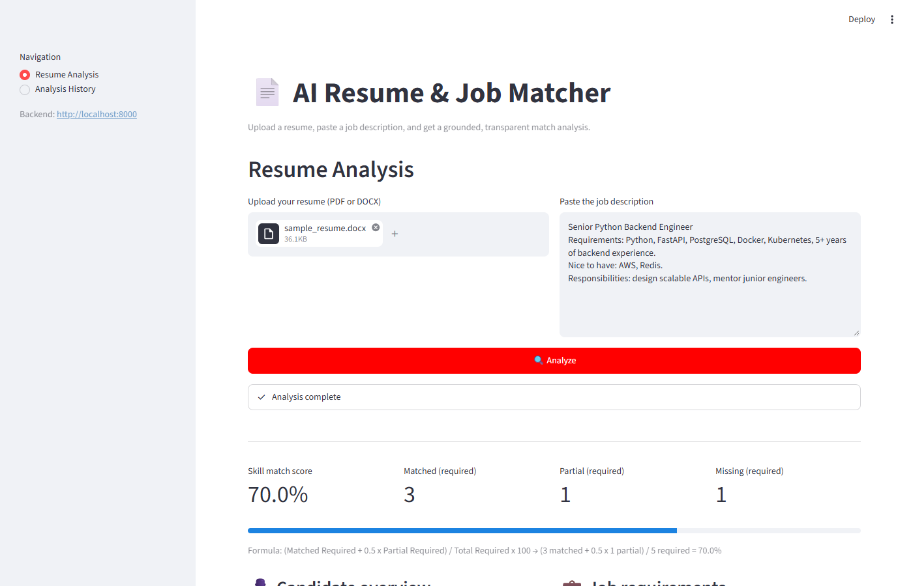
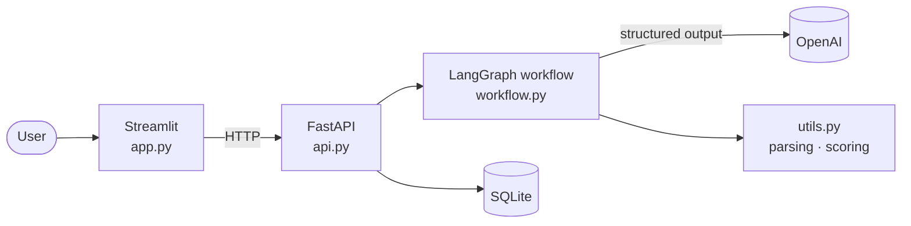
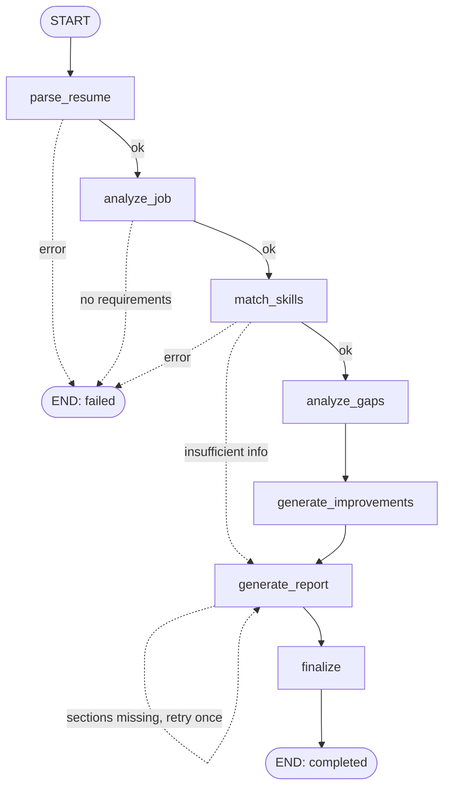
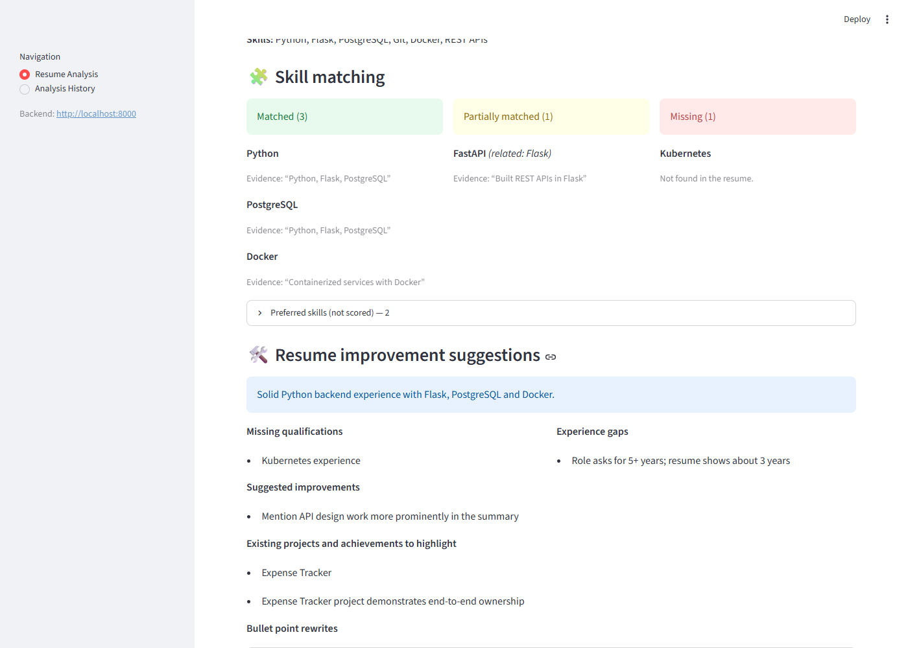
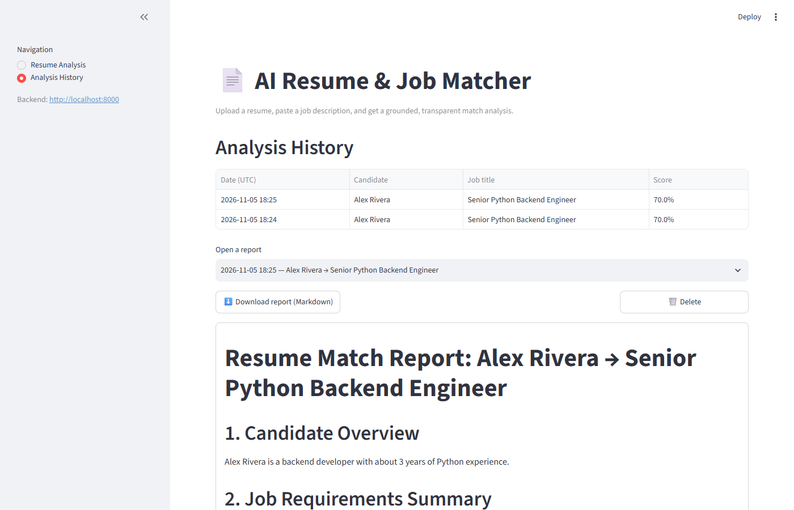

# 📄 AI Resume & Job Matcher

An AI-powered tool that compares a resume with a job description and produces a **grounded, transparent match analysis**. It extracts skills and experience, scores the required-skill match with a deterministic formula, highlights gaps, and suggests resume improvements without inventing anything.

Built with **LangGraph · LangChain · OpenAI · FastAPI · Streamlit · Pydantic · SQLite**.



---

## ✨ Features

- 📤 Upload a resume as **PDF or DOCX** and paste a job description
- 🧠 Structured extraction of the resume and job requirements (Pydantic-validated LLM output)
- 🧩 Skill matching: **Exact / Partial / Missing**, each backed by a quote from the resume
- 📊 **Deterministic score**: `(Matched + 0.5 × Partial) / Required × 100`, calculated in Python, not by the LLM
- 🔍 Gap analysis: missing qualifications, experience gaps, under-highlighted projects
- ✍️ Resume improvement suggestions, with filtering that removes fabricated bullets, metrics and keywords
- 📄 A 9-section Markdown report you can download
- 🗂️ Analysis history (SQLite): open, download or delete earlier reports
- 🛡️ Clear error messages for bad files, empty input, LLM/API failures and invalid output
- ✅ 40 automated tests that run **without an API key** (mocked LLM)

---

## 🏗️ Architecture



### LangGraph workflow



📘 **See [docs/ARCHITECTURE.md](docs/ARCHITECTURE.md)** for the full write-up: every node, the state fields, routing rules, scoring, anti-fabrication guardrails, a request sequence diagram, the data model, error handling and design decisions.

---

## 📁 Project structure

```
ai-resume-matcher/
├── app.py              # Streamlit UI (analysis + history pages)
├── api.py              # FastAPI backend (/analyze, /history)
├── workflow.py         # LangGraph state, nodes, routing, report rendering
├── models.py           # Pydantic schemas for structured LLM output
├── utils.py            # PDF/DOCX parsing, cleaning, scoring, SQLite
├── requirements.txt
├── .env.example
├── tests/
│   └── test_workflow.py
└── docs/
    ├── ARCHITECTURE.md
    ├── sample_report.md
    └── screenshots/
```

---

## 🚀 Getting started

### 1. Prerequisites
- Python **3.11+** recommended (the code is also tested on 3.10)
- An [OpenAI API key](https://platform.openai.com/api-keys)

### 2. Install

```bash
git clone https://github.com/saif-siddiqui06/ai-resume-matcher.git
cd ai-resume-matcher

python -m venv .venv
# Windows
.venv\Scripts\activate
# macOS / Linux
source .venv/bin/activate

pip install -r requirements.txt
```

### 3. Configure

```bash
cp .env.example .env      # Windows: copy .env.example .env
```

Edit `.env`:

| Variable | Default | Description |
|----------|---------|-------------|
| `OPENAI_API_KEY` | — | **Required.** Your OpenAI key |
| `OPENAI_MODEL` | `gpt-4o-mini` | Any chat model that supports tool calling |
| `OPENAI_TEMPERATURE` | `0` | Low values give consistent extraction |
| `DATABASE_PATH` | `analyses.db` | SQLite file for history |
| `BACKEND_URL` | `http://localhost:8000` | Where Streamlit reaches the API |

### 4. Run (two terminals)

```bash
# Terminal 1: backend
uvicorn api:app --reload

# Terminal 2: frontend
streamlit run app.py
```

Open **http://localhost:8501**. Interactive API docs are at **http://localhost:8000/docs**.

---

## 🖥️ Usage

1. **Resume Analysis** page: upload a PDF/DOCX resume, paste the job description and click **Analyze**.
2. Review the score, matched/partial/missing skills with evidence, gaps and suggested rewrites.
3. Click **Download report (Markdown)** to save it.
4. **Analysis History** page: open, download or delete previous reports.

| Skill matching & suggestions | History |
|---|---|
|  |  |

See a full example report in [docs/sample_report.md](docs/sample_report.md).

> Screenshots and the sample report were generated from **synthetic data** with a mocked LLM.

### API example

```bash
curl -X POST http://localhost:8000/analyze \
  -F "resume=@my_resume.pdf" \
  -F "job_description=Senior Python Engineer. Requirements: Python, FastAPI, Docker..."
```

| Method | Endpoint | Description |
|--------|----------|-------------|
| `POST` | `/analyze` | Run an analysis (multipart: `resume`, `job_description`) |
| `GET` | `/history` | List previous analyses |
| `GET` | `/history/{id}` | Get one analysis with its report |
| `DELETE` | `/history/{id}` | Delete an analysis |
| `GET` | `/health` | Health check |

---

## 📊 How the score works

```
Match Score = (Matched Required + 0.5 × Partially Matched Required) / Total Required × 100
```

- Each required skill is counted **once**.
- **Preferred** skills are shown separately and don't affect the score.
- A match without supporting resume evidence counts as **missing**.
- If the job lists no required skills, the score is reported as **N/A** with an explanation.

Example: 3 exact + 1 partial out of 5 required → `(3 + 0.5) / 5 × 100 = 70%`.

---

## 🛡️ No fabrication

The system **never adds skills, experience, certifications or metrics** the candidate doesn't have:

- Prompts restrict the model to information present in the documents.
- Every skill match must quote the resume.
- Bullet rewrites are dropped if the original bullet isn't in the resume or if the rewrite adds new numbers.
- Suggested keywords must be supported by the resume.
- Scores and skill lists in the report come from validated data, not LLM prose.

---

## ✅ Testing

```bash
pytest -v
```

The 40 tests mock the LLM, so **no API key or network access is needed**. They cover extraction, validation, schemas, each node, scoring edge cases, routing (failures, insufficient info, report regeneration), SQLite and the API.

---

## 🧭 Possible extensions

- Stream node-by-node progress to the UI (LangGraph `stream()` + server-sent events)
- OCR for scanned PDFs
- Embedding-based semantic skill matching
- Multiple job descriptions per resume, with ranking
- Authentication and per-user history

