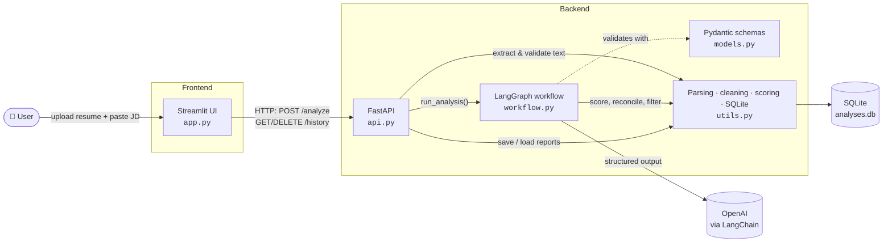
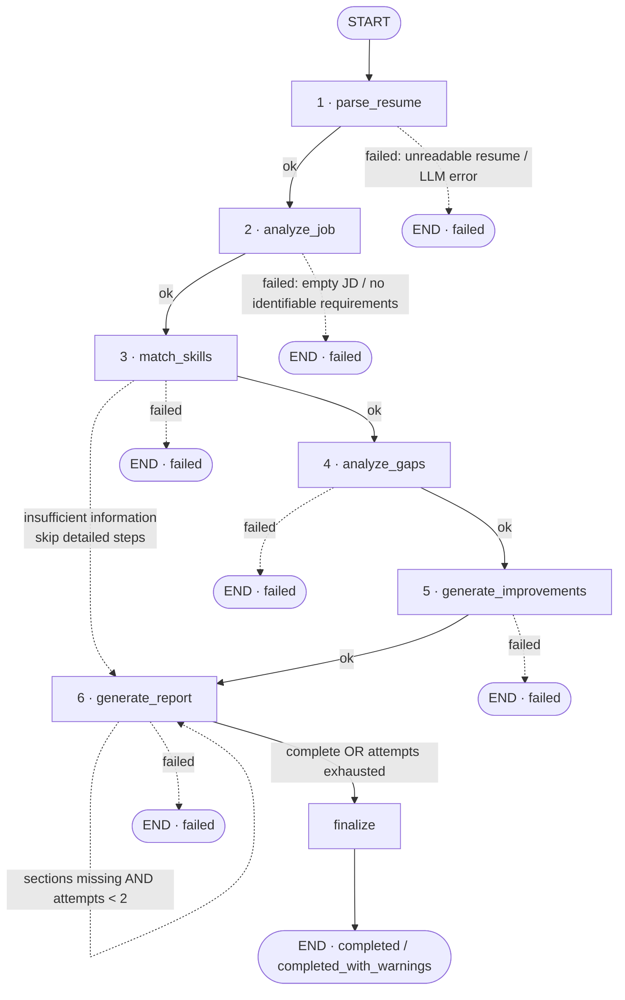
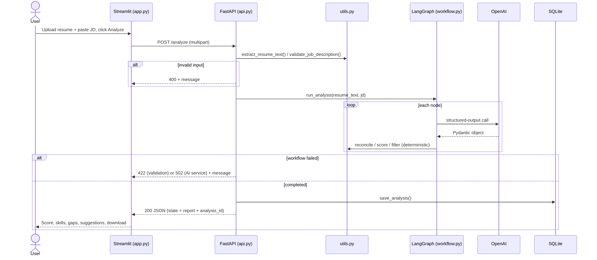
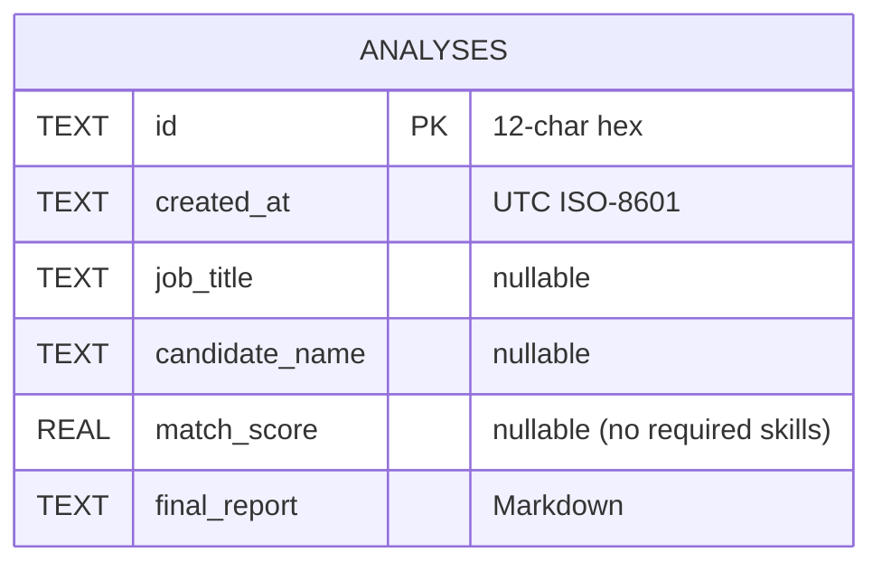

# Architecture & Project Explanation

This document explains **how the AI Resume & Job Matcher works end to end**: the components, the
LangGraph workflow, how data flows through it, how the score is calculated, how the system avoids
fabricating information, and why it was designed this way.

---

## 1. What the project does

A user uploads a resume (PDF/DOCX) and pastes a job description. The system:

1. Extracts structured information from the resume (name, contact, education, experience, projects, skills, certifications, achievements).
2. Extracts structured requirements from the job description (title, seniority, required/preferred skills, experience, education, responsibilities).
3. Classifies every job skill as **Exact match**, **Partial match** or **Missing**, each backed by a quote from the resume.
4. Calculates a **transparent, deterministic** match score in Python.
5. Identifies gaps and generates **resume-grounded** improvement suggestions.
6. Produces a 9-section Markdown report that can be viewed, saved to history and downloaded.

---

## 2. System architecture



| Layer | File | Responsibility |
|-------|------|----------------|
| Frontend | `app.py` | Upload form, progress indicator, results dashboard, history browser, Markdown download. Talks to the backend over HTTP only. |
| Backend API | `api.py` | Receives uploads, extracts text **in memory** (files are never written to disk), runs the workflow, maps failures to HTTP status codes, persists results. |
| Orchestration | `workflow.py` | LangGraph `StateGraph`: typed state, 6 LLM-backed nodes + a `finalize` node, conditional routing, report rendering and validation. |
| Schemas | `models.py` | Pydantic models used as LLM **structured output** schemas and for validation. |
| Utilities | `utils.py` | Deterministic, LLM-free code: PDF/DOCX extraction, text cleaning, skill normalisation, match reconciliation, scoring, SQLite CRUD. |

**Why split frontend and backend?** The FastAPI layer makes the analysis engine reusable by any client
(curl, another UI, a scheduled job) and keeps Streamlit a thin presentation layer. Interactive API docs
are generated automatically at `/docs`.

---

## 3. The LangGraph workflow

### 3.1 Graph

This diagram mirrors the graph compiled by `build_graph()` (dashed arrows are conditional edges).



### 3.2 Nodes

| # | Node | LLM schema | What it does | Deterministic post-processing |
|---|------|-----------|--------------|-------------------------------|
| 1 | `parse_resume` | `ParsedResume` | Extracts candidate data; bullets copied verbatim. | Validates the text isn't empty first (no LLM call if it is); de-duplicates skills. |
| 2 | `analyze_job` | `JobRequirements` | Extracts title, seniority, required/preferred skills, experience/education/certifications, responsibilities. | De-duplicates; removes preferred skills that are also required; raises a **validation error** if nothing identifiable was extracted; warns if there are no *required* skills. |
| 3 | `match_skills` | `SkillMatchResult` | Classifies each job skill as exact / partial / missing with a resume quote as evidence and an optional transferable skill. | `reconcile_matches()` + `calculate_match_score()` (see §5). Skips the LLM entirely if the resume has no skills, experience or projects. |
| 4 | `analyze_gaps` | `GapAnalysis` | Missing qualifications, experience gaps, under-highlighted items, weak sections, specific improvements. | — |
| 5 | `generate_improvements` | `ImprovementSuggestions` | Strengths summary, bullet rewrites, projects/skills to highlight, supported keywords. | `filter_grounded_suggestions()` removes anything not supported by the resume (see §6). |
| 6 | `generate_report` | `ReportNarrative` | Writes only the **prose** parts: overview, JD summary, score explanation, next steps. | `render_report()` assembles all 9 sections; numbers and skill lists come from state, not the LLM. |
| — | `finalize` | — | Terminal node. | If sections are still missing after the retry, fills them with deterministic fallback text; sets the final status. |

Each node is a plain function `node(state, llm) -> dict` that returns **only the keys it changes**.
`build_graph()` binds the LLM with `functools.partial`, which lets tests inject a fake LLM.

### 3.3 Conditional routing rules

| Situation | Where detected | Result |
|-----------|---------------|--------|
| Resume unreadable / empty / LLM error while parsing | `parse_resume` | Stop → `failed` with a clear `error_message`. |
| Empty JD, or JD with no identifiable requirements | `analyze_job` | Stop → `failed` with a validation message. |
| JD has requirements but **no required skills** | `analyze_job` | Continue; score is `None` with an explanatory message and a warning. |
| Resume has no skills, experience or projects | `match_skills` | Warning; skip gap & improvement nodes; go straight to the report. |
| LLM/API failure in any later node | that node | Stop → `failed`. |
| Report missing required sections | `route_after_report` | Regenerate **once** (`MAX_REPORT_ATTEMPTS = 2`), then `finalize` fills gaps. |

**Termination guarantee:** every router either moves forward or returns `END`. The only back-edge
(`generate_report → generate_report`) is guarded by an attempt counter, and `invoke()` also uses a
`recursion_limit` of 25 as a final safety net.

---

## 4. State

`ResumeMatchState` is a `TypedDict` shared by all nodes. Structured values are stored as plain dicts
(`model_dump()`), which keeps the final state JSON-serialisable for the API.

| Field | Written by | Description |
|-------|-----------|-------------|
| `resume_text` | input / `parse_resume` | Cleaned resume text (original preserved for evidence). |
| `job_description` | input / `analyze_job` | Cleaned job description. |
| `parsed_resume` | `parse_resume` | `ParsedResume` dict. |
| `job_requirements` | `analyze_job` | `JobRequirements` dict. |
| `skill_matches` | `match_skills` | `{"required": [SkillMatch], "preferred": [SkillMatch]}`. |
| `match_score` | `match_skills` | `MatchScore` dict (score, counts, formula, message). |
| `gap_analysis` | `analyze_gaps` | `GapAnalysis` dict. |
| `improvement_suggestions` | `generate_improvements` | `ImprovementSuggestions` dict. |
| `final_report` | `generate_report` / `finalize` | Markdown report. |
| `workflow_status` | any | `running` → `failed` / `insufficient_information` → `completed` / `completed_with_warnings`. |
| `error_message` | any failing node | User-friendly error. |
| `report_narrative`, `report_attempts`, `warnings` | bookkeeping | Retry counter, LLM prose, accumulated warnings. |

---

## 5. Scoring: transparent and deterministic

The LLM **never produces a percentage**. It classifies skills; Python counts:

```
Match Score = (Matched Required + 0.5 × Partially Matched Required) / Total Required × 100
```

Before scoring, `reconcile_matches()` aligns the LLM output with the job's skill list:

- **One entry per required skill.** Duplicates (case/spacing-insensitive) are counted once.
- **Forgotten skills → Missing.** If the LLM skipped a skill, it is added as missing.
- **Invented skills are dropped.** Entries that are not job skills are ignored.
- **No evidence → Missing.** An exact/partial match without a resume quote is downgraded.

Preferred skills are reported separately and **do not affect** the score. If there are no required skills,
`score = None` and the message explains why (no division by zero).

Example: required = Python, FastAPI, PostgreSQL, Docker, Kubernetes; the candidate has 3 exact,
1 partial (FastAPI via Flask) and 1 missing → `(3 + 0.5 × 1) / 5 × 100 = 70.0%`.

---

## 6. Anti-fabrication guardrails

| Layer | Guardrail |
|-------|-----------|
| Prompts | Every system prompt includes grounding rules: use only information present in the documents; leave unknown fields empty. |
| Schemas | All optional fields default to empty/`None`, so "not found" is a valid answer and the model isn't forced to invent values. |
| Matching | Every match requires a resume quote; an ungrounded match is downgraded to *missing*. |
| Bullet rewrites | Dropped unless the original bullet actually exists in the resume, **and** dropped if the rewrite introduces numbers that weren't in the original (no invented metrics). |
| Keywords | Kept only if they appear in the resume or are matched/partially matched skills. |
| Report | The LLM writes prose only; scores, skill lists and gaps are rendered from validated state. |

---

## 7. Request lifecycle



---

## 8. Data model (SQLite)



Only the **report** and summary metadata are stored. Uploaded resume files are processed in memory
and never persisted.

---

## 9. Error handling

| Case | Where | User sees |
|------|-------|-----------|
| Unsupported format (not PDF/DOCX) | `utils.extract_resume_text` | 400 "Unsupported file format…" |
| Empty file, scanned/image PDF, corrupt file | `utils` | 400 "The resume appears to be empty or unreadable…" |
| Empty job description | `utils.validate_job_description` | 400 "The job description is empty…" |
| File > 5 MB | `api.analyze` | 413 |
| Missing API key | `workflow.get_llm` | 502 "Could not start the analysis: OPENAI_API_KEY is not set…" |
| LLM/API error (auth, rate limit, timeout) | any node | 502 "<Step> failed because the AI service returned an error: …" |
| Invalid structured output | any node | 422 "<Step> returned invalid structured output: …" |
| No identifiable requirements | `analyze_job` | 422 validation error |
| No required skills | `match_skills` | Completed with warning; score "N/A" |
| Database error | `utils._connect` → `api` | 500, or a warning if only saving failed |
| Backend not running | `app.api_request` | "Cannot reach the backend at … Start it with uvicorn…" |

---

## 10. Testing strategy

`tests/test_workflow.py` (40 tests) runs **without an API key**. A small `FakeLLM` implements
`with_structured_output(schema).invoke()` and returns predefined Pydantic objects (or raises
exceptions) per schema. That makes it possible to test:

- PDF/DOCX extraction (files generated in-memory), format/empty/corrupt validation, text cleaning
- Pydantic schema validation
- Each node in isolation (success, invalid output, empty input, no requirements, insufficient info)
- Reconciliation and scoring edge cases (duplicates, no required skills, preferred skills ignored, 0% / 100%)
- Anti-fabrication filtering
- Full graph runs: happy path, parse failure, mid-workflow LLM failure, report regeneration, fallback termination, missing API key
- SQLite CRUD and error wrapping
- FastAPI endpoints via `TestClient`

All fixtures are synthetic (`example.com` emails, fictional names and companies).

---

## 11. Design decisions

| Decision | Reason |
|----------|--------|
| Linear graph with guarded branches, not a multi-agent system | The task is a pipeline; conditional edges give robustness without the cost and unpredictability of agent loops. |
| LLM classifies, Python scores | Scores are reproducible, explainable and testable. |
| Structured output for every LLM call | Pydantic validation catches malformed responses early and gives typed data to later nodes. |
| LLM injected into nodes | Unit tests with no network or key; the provider could be swapped easily. |
| `method="function_calling"` for structured output | Works with optional/defaulted fields across OpenAI models. |
| Report = LLM prose + Python-rendered facts | The narrative reads naturally, while the numbers stay exactly what was computed. |
| Five core files + `api.py` | Simple to read for learners; `api.py` is the one addition needed for a FastAPI backend. |
